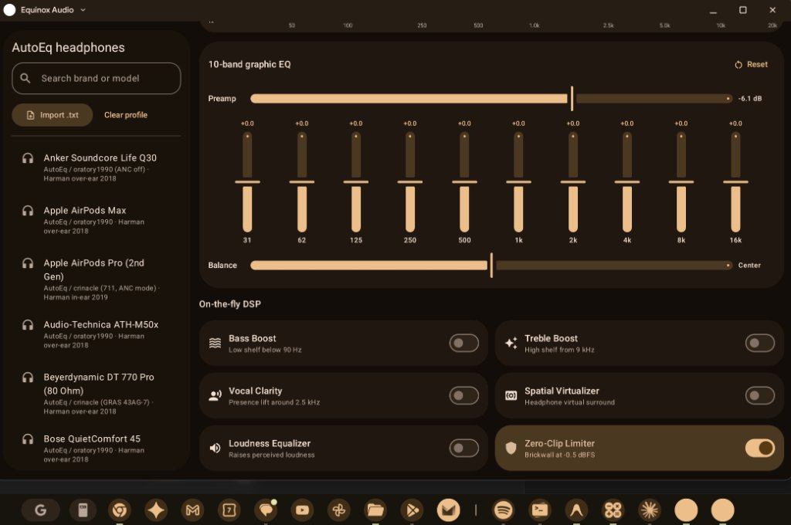

# Equinox Audio 🎚️🔊

[](.github/workflows/android.yml)
[](https://github.com/andrewnoonan2004/equinox-audio/releases/tag/v1.0.0)
[](https://developer.android.com/about/versions/12)
[](https://developer.android.com)
[](https://m3.material.io)
[](LICENSE)

**Equinox Audio** is a desktop & tablet-optimized audio equalizer and studio DSP suite for Android and ChromeOS. Built with Material 3 Expressive, AutoEQ headphone database calibration, and system-wide audio effect routing, Equinox Audio provides a full two-pane studio experience with real-time parametric frequency tuning and instant on-the-fly acoustic DSP enhancements.

---

## 📱 Application Interface

<div align="center">
  
  <p><em>Equinox Audio running on ChromeOS in Dual-Pane Studio layout with dynamic wallpaper theming and AutoEQ headphone calibration.</em></p>
</div>

---

## 🌟 Key Features

### 1. 🎛️ 10-Band Graphic & Parametric Equalizer
- **10 ISO Octave Bands**: 31 Hz, 62 Hz, 125 Hz, 250 Hz, 500 Hz, 1 kHz, 2 kHz, 4 kHz, 8 kHz, and 16 kHz.
- **Preamp Gain Slider**: Adjustable digital pre-amplification fader (-12 dB to +12 dB).
- **Stereo Balance**: Fine-grain left/right channel balancing.
- **Real-Time Visualizer Curve**: Live frequency response curve overlay.

### 2. 🎧 AutoEQ Headphone Calibration Database
- Instant one-tap compensation profiles for popular audiophile and consumer headphones:
  - *Sony*: WH-1000XM4, WH-1000XM5
  - *Apple*: AirPods Pro (2nd Gen), AirPods Max
  - *Sennheiser*: HD 600, HD 650
  - *Beyerdynamic*: DT 770 Pro (80 Ohm), DT 990 Pro
  - *Audio-Technica*: ATH-M50x
  - *Anker*: Soundcore Life Q30
  - *Bose*: QuietComfort 45
- **Universal Custom Profile Importer**: Tap **Import .txt** to load custom Parametric EQ or GraphicEQ text files.

### 3. ⚡ On-The-Fly DSP Suite
- **Bass Boost**: Low-shelf sub-harmonic enhancement below 90 Hz.
- **Treble Boost**: High-shelf presence lift above 9 kHz.
- **Vocal Clarity**: Vocal intelligibility boost centered around 2.5 kHz.
- **Spatial Virtualizer**: 3D binaural headphone surround stage expansion.
- **Loudness Equalizer**: Perceived loudness raiser for quiet tracks.
- **Zero-Clip Limiter**: Brickwall distortion limiter at -0.5 dBFS.

### 4. 🖥️ Large Screen & ChromeOS Desktop Optimization
- **Responsive Studio Layouts**: Automatically adapts between DualPane, Navigation Rail, and Compact Drawer depending on window dimensions.
- **ChromeOS Title Bar Matching**: Seamlessly syncs window caption bar color and controls with light and dark modes.
- **Picture-in-Picture (PiP)**: Keep an interactive mini studio fader pinned to your desktop.

---

## 🚀 Building & Installation

### Build Release APK (Non-Debug, Signed)
```bash
./gradlew assembleRelease
```
Output: `app/build/outputs/apk/release/EquinoxAudio-release.apk`

### Build Debug APK
```bash
./gradlew assembleDebug
```
Output: `app/build/outputs/apk/debug/EquinoxAudio-debug.apk`

### Install onto Device via ADB
```bash
adb install -r app/build/outputs/apk/release/EquinoxAudio-release.apk
```
